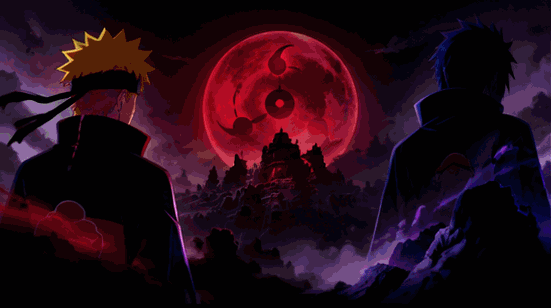

 <!-- NARUTO AND SASUKE ANIMATED BANNER -->

  

  <strong>
    ⚡ ASPIRING DEVELOPER | NEVER GIVE UP ⚡
  </strong>

---           
 <picture>
  <source
    media="(prefers-color-scheme: dark)"
    srcset="https://raw.githubusercontent.com/tofansahu1981-glitch/tofansahu1981-glitch/main/dark.svg">
  <source
    media="(prefers-color-scheme: light)"
    srcset="https://raw.githubusercontent.com/tofansahu1981-glitch/tofansahu1981-glitch/main/light.svg">
  
</picture>

<!-- ================= ABOUT ME ================= -->

<h2 align="center">⚡ About Me | 忍者 Developer ⚡</h2>

  <b>Building • Learning • Improving • Creating</b>

  Hello! 👋 I'm a beginner developer passionate about
  programming, technology, and building creative projects.
    
  🚀 Currently learning and improving my coding skills. 
  💻 Exploring Web Development and Software Development. 
  🐍 Learning Python and Java. 
  🎯 Focused on writing clean code and building real projects. 
  🍥 Inspired by Naruto's determination and never-give-up mindset.

  
  

---

<!-- ================= TECH STACK ================= -->

<h2 align="center">⚔️ My Tech Stack</h2>

  Technologies I'm learning and working with:

  

  
  
  
  

  
  
  
  

---

<!-- ================= NINJA MINDSET ================= -->

<h2 align="center">🍥 Ninja Mindset</h2>

  <i>"Train hard. Write code. Never give up."</i>

  🔥 Every bug is a lesson. Every project is progress.

