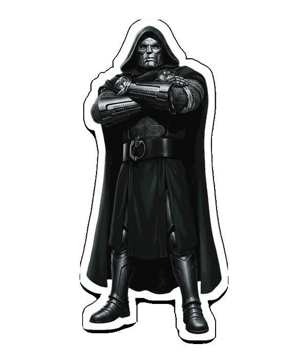
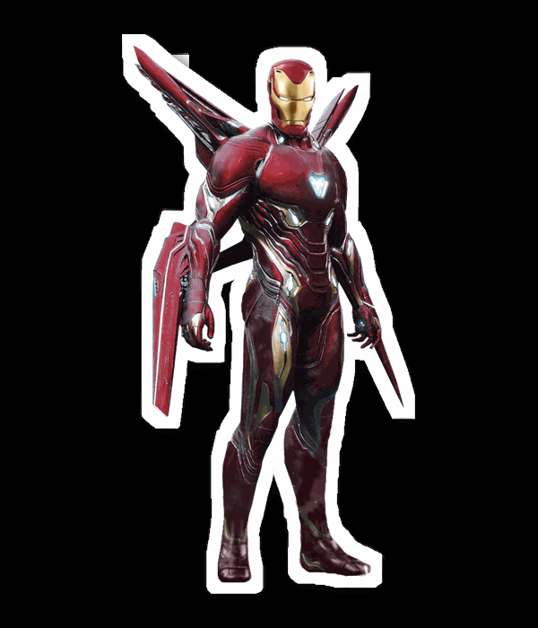

     
  <!-- 🕷️ ANIMATED SUPERHERO STICKERS -->

  
  
  

<h1 align="center">🕷️ TOFAN SAHU</h1>

<h3 align="center">SPIDER-VERSE DEVELOPER</h3>
 
# 🕷️ TOFAN SAHU

### SPIDER-VERSE DEVELOPER

**Developer in Progress · Building · Learning · Creating**

---

<h2 align="center">🕷️ SPIDER-MAN ANIMATED PROFILE</h2>

  

## 🕸️ ABOUT MY SPIDER-VERSE

---

## ⚡ MY TECHNOLOGY UNIVERSE

---

## 🪪 MY DEVELOPER ID & MISSION DASHBOARD

---

## 📊 GITHUB STATISTICS

 

---

## 🚀 FEATURED PROJECTS

| Project | Description | Technology |
|---|---|---|
| Project One | Add your project description | HTML, CSS |
| Project Two | Add your project description | JavaScript |
| Project Three | Add your project description | Python |

---

## 🌐 CONNECT WITH ME

### 🕷️ THANKS FOR VISITING MY PROFILE

**KEEP LEARNING · KEEP BUILDING · KEEP GROWING**

*With great code comes great responsibility.*

